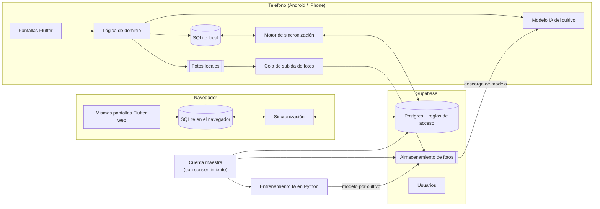
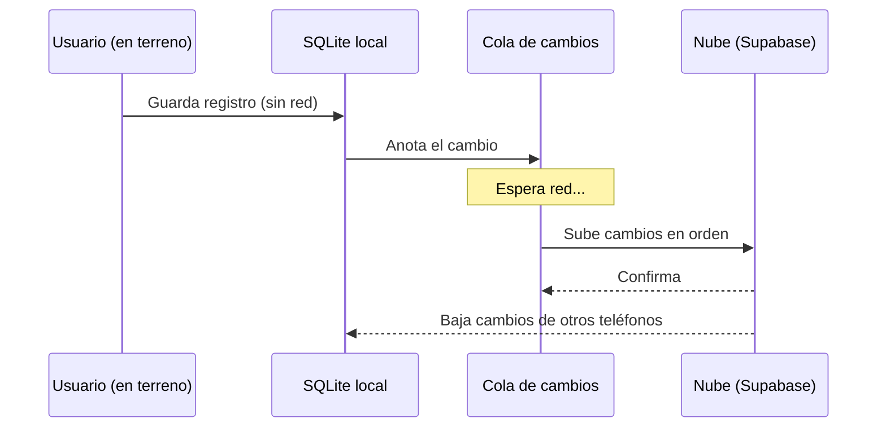

# 01 · Arquitectura

## Vista general



## Principios

1. **Sin conexión primero.** La app solo lee y escribe en la base local. La nube nunca es
   necesaria para trabajar; la sincronización ocurre de fondo cuando hay red.
2. **Identificadores creados en el teléfono (UUID).** Dos teléfonos pueden crear registros
   al mismo tiempo sin chocar.
3. **Cultivos como datos, no como código.** Escala fenológica, variedades, mediciones y
   reglas de IA de cada cultivo son registros (o un archivo JSON importable), no pantallas
   programadas a mano.
4. **Capas separadas.** Pantallas → lógica de dominio (reglas puras, fáciles de probar) →
   repositorios (base local) → sincronización. Así se puede probar la lógica sin teléfono.
5. **Fotos aparte de los datos.** El registro guarda la referencia; el archivo vive en el
   teléfono y se sube por una cola con reintentos (y opción «solo Wi-Fi»).

## Cómo funciona la sincronización



**Conflictos** (dos personas editan el mismo registro sin red):
- Regla por defecto: **gana la última edición por campo** (no por registro completo), así
  una persona que corrige la nota y otra que cambia el estadio no se pisan.
- Fotos y mediciones son registros independientes: se suman, no se sobrescriben.
- Todo cambio queda en la **bitácora** (quién, cuándo, qué valor había antes).

## Organización del código (propuesta)

```
app/                      Proyecto Flutter
  lib/
    core/                 utilidades comunes (fechas, semanas, UUID, errores)
    domain/               reglas puras: semanas, completitud, escala, nombres de fotos
    data/                 base Drift, tablas, repositorios, sincronización
    features/
      crops/              cultivos, escalas, variedades
      projects/           ensayos y predios, unidades
      sampling/           semanas y registros con fotos
      reports/            informes (etapa posterior)
      ai/                 sugerencia de estadio (etapa posterior)
  test/                   pruebas unitarias y de pantallas
crops/                    definiciones de cultivos en JSON (frambueso primero)
supabase/                 migraciones SQL, reglas de acceso, funciones
ml/                       entrenamiento de IA en Python (etapa posterior)
docs/                     documentación
```
