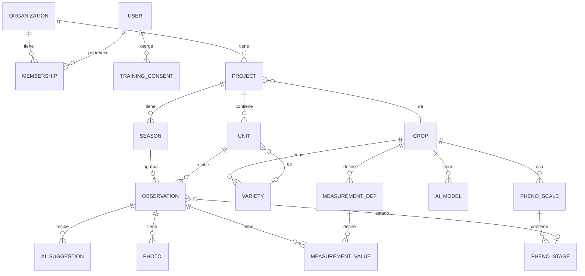

# 02 · Modelo de datos

Todas las tablas tienen además: `id` (UUID creado en el teléfono), `created_at`,
`updated_at`, `deleted_at` (borrado lógico, necesario para sincronizar) y `updated_by`.

## Diagrama

## Catálogo de cultivos (configurable sin código)

| Tabla | Campos principales | Notas |
|---|---|---|
| `crop` | `code` (p. ej. `rubus-idaeus`), `name`, `scientific_name`, `default_season_start` (mes-día), `organization_id` (nulo = cultivo global) | Un cultivo global lo ves todos; uno de organización es privado. |
| `pheno_scale` | `crop_id`, `name` (p. ej. «BBCH frambueso»), `version`, `is_default` | Un cultivo puede tener varias escalas (BBCH, escala propia…). |
| `pheno_stage` | `scale_id`, `code` (texto: `"61"`, `"89-1"`), `macro_code`, `sort_order`, `name`, `description`, `color`, `organ` (p. ej. caña anual, brote lateral) | `sort_order` permite comparar «más adelantado» aunque el código sea texto. |
| `variety` | `crop_id`, `organization_id`, `name`, `code`, `notes`, `archived` | |
| `measurement_def` | `crop_id` o `project_id`, `name`, `kind` (`number`, `integer`, `text`, `choice`, `image`), `unit`, `min`, `max`, `choices`, `scope` (`observation` o `variety_season`) | Sirve para mediciones semanales y para parámetros por variedad (rendimiento, cañas…). |
| `ai_model` | `crop_id`, `scale_id`, `version`, `file_path`, `labels` (lista de códigos de estadio), `input_size`, `rules` (JSON) | `rules` guarda reglas como «no retroceder de estadio» o máximo avance por semana. |

Un cultivo completo se puede **exportar/importar como un archivo JSON**
(`crops/rubus-idaeus.json`), así agregar arándano o cerezo es cargar un archivo, no programar.

## Organización y trabajo de campo

| Tabla | Campos principales | Notas |
|---|---|---|
| `organization` | `name` | Tu espacio; a futuro, cada empresa cliente. |
| `membership` | `organization_id`, `user_id`, `role` (`owner`, `editor`, `viewer`) | |
| `project` | `organization_id`, `crop_id`, `scale_id`, `kind` (`variety_trial`, `treatment_trial`, `farm`), `name`, `archived` | Reemplaza «ensayo» y «predio» con un solo concepto. Cada proyecto tiene sus datos separados. |
| `season` | `project_id`, `name` (p. ej. «2026-27»), `week1_start` (fecha) | La semana 1 es configurable por temporada. |
| `unit` | `project_id`, `variety_id`, `label`, `treatment`, `replicate`, `sector`, `irrigation_group`, `sort_order`, `lat`, `lon` | Una sola tabla sirve para variedad, tratamiento × repetición y sector de predio. |
| `week_status` | `season_id`, `week_number`, `not_sampled` (sí/no), `note` | Para marcar semanas no muestreadas. |
| `observation` | `season_id`, `unit_id`, `week_number`, `stage_id`, `stage_source` (`manual`, `ai_accepted`, `ai_corrected`), `notes`, `observed_at`, `lat`, `lon`, `location_source` (`gps`, `map`, `photo`) | Única por (`season_id`, `unit_id`, `week_number`). Completa = tiene estadio y al menos una foto. |
| `photo` | `observation_id`, `kind` (`general`, `detail`, `extra`), `seq`, `file_name`, `local_path`, `storage_path`, `upload_status`, `width`, `height`, `taken_at`, `lat`, `lon`, `caption` | Nombre de archivo estándar generado por la app (ver abajo). |
| `measurement_value` | `observation_id` (o `variety_id`+`season_id`), `def_id`, `value_num`, `value_text`, `photo_id` | |
| `ai_suggestion` | `observation_id`, `photo_id`, `model_id`, `top` (JSON: códigos + confianza), `accepted_stage_id` | Guarda qué propuso la IA y qué eligió la persona: es oro para reentrenar. |
| `audit_log` | `table`, `row_id`, `field`, `old_value`, `new_value`, `user_id`, `at` | Bitácora de cambios. |

### Nombre de las fotos (nuevo formato)

`<aaaammdd>_<cultivo>_<unidad>_<tipo><n>.jpg`, por ejemplo
`20261102_RUB_HER-S3E2_D1.jpg` (fecha, código de cultivo, etiqueta corta de la unidad,
`G`/`D`/`X` = general/detalle/extra y número correlativo). Se confirma en la etapa 1.

## Cuenta maestra y consentimiento para la IA

| Tabla | Campos principales | Notas |
|---|---|---|
| `training_consent` | `user_id`, `organization_id`, `scope` (`photos_and_labels`), `granted_at`, `revoked_at`, `terms_version` | Cada usuario decide; se puede revocar. |
| `training_sample` (vista en la nube) | foto + estadio confirmado + cultivo + escala + variedad + semana | Solo incluye datos con consentimiento vigente. Sin nombres de predios ni ubicación exacta, salvo que el consentimiento lo permita. |

- La cuenta maestra tiene el rol global `trainer`: **solo lectura** de la vista
  `training_sample`, nunca de los proyectos completos de otros.
- Si alguien revoca el consentimiento, sus datos salen de la vista y del próximo conjunto
  de entrenamiento (los modelos ya entrenados no se pueden «desentrenar»; eso se explica en
  el texto del consentimiento).

## Semanas

`week_number = floor((fecha − week1_start) / 7) + 1`. En pantalla se muestra además la
semana ISO y el año calendario («Semana 44, 2026 · desde el 26 de octubre»). Es una regla
pura en `domain/` con pruebas propias.
