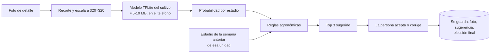

# 07 · Modelo de IA para sugerir el estadio fenológico

Propuesta para las etapas 6 y 7. Nada de esto está construido aún.

## Qué hace

En terreno, al tomar la **foto de detalle**, la app sugiere los **3 estadios más
probables** con su confianza (p. ej. «61 Inicio de floración 72 % · 60 18 % · 65 6 %»). La
persona elige; la IA nunca decide sola. Todo ocurre **en el teléfono, sin internet**.

## El modelo

| Aspecto | Propuesta | Por qué |
|---|---|---|
| Tipo | **Clasificador de imágenes** | Una foto de detalle → un estadio. Es el problema más simple que resuelve la necesidad. |
| Arquitectura | **EfficientNet-Lite0** o **MobileNetV3-Large** preentrenada en ImageNet, con *transfer learning* | Funcionan bien con pocos miles de fotos, corren en < 100 ms en un teléfono de gama media y existen en TFLite. |
| Entrada | Foto de detalle, 320 × 320 px | Suficiente para ver yemas, flores y frutos de cerca; el teléfono ya guarda a 2048 px. |
| Salida | Probabilidad para cada estadio de la escala (hoy 34 del BBCH frambueso) | Los estadios con muy pocas fotos se agrupan con su vecino hasta tener datos (p. ej. 65 + 67). |
| Formato | **TensorFlow Lite cuantizado a 8 bits**, ≈ 5-10 MB | Corre sin internet; en Flutter con el paquete `tflite_flutter`. |
| Versión | Un archivo por cultivo y escala, con número de versión | El teléfono descarga del servidor el modelo nuevo cuando existe (tabla `ai_model` del modelo de datos). |

### Reglas agronómicas después del modelo

La red solo ve la foto. Las reglas usan lo que sabemos de la unidad:

1. **No retroceder**: un estadio anterior al de la semana pasada baja mucho su
   probabilidad (salvo error de registro).
2. **Ritmo semanal**: no avanzar más de N posiciones en la escala por semana (N se
   ajusta con los datos reales de cada cultivo).
3. **Época**: estadios imposibles para la semana de temporada se penalizan.

Las reglas reordenan el top 3; siempre se puede elegir cualquier estadio de la escala.

## Entrenamiento (etapa 7)

1. **Datos**: tus fotos ya etiquetadas + las que se registren en la app (solo de quienes
   dan consentimiento). Cada foto lleva su estadio elegido, variedad, semana y si la IA
   acertó.
2. **Separación honesta**: se entrena con unas temporadas o predios y se evalúa con
   **otros**, para medir el desempeño real en terreno (no con fotos casi iguales a las del
   entrenamiento).
3. **Entrenamiento en Python** (TensorFlow/Keras) en un computador con GPU o en Google
   Colab; aumentos de datos (luz, giro, recorte, desenfoque).
4. **Métricas**: acierto top-1 y **top-3**, y matriz de confusión por estadio. Meta
   inicial razonable: top-3 ≥ 90 %.
5. **Publicar**: exportar a TFLite, subir al servidor; los teléfonos lo descargan.
6. **Mejora continua**: cada «aceptado/corregido» vuelve al conjunto de datos.

## Cuántas fotos hacen falta

Como guía: **≥ 50-100 fotos de detalle por estadio** para empezar (los estadios con menos
se agrupan). Con ~500 fotos por temporada, el primer modelo útil se logra combinando tus
fotos etiquetadas actuales con una temporada de uso de la app.

## Qué necesito para partir

1. Las fotos ya etiquetadas: idealmente una carpeta por estadio (`61/`, `65/`, …) o una
   planilla con nombre de archivo y estadio.
2. Saber cuántas son y si son de detalle o generales.
3. Un computador con GPU o una cuenta de Google Colab para entrenar.
